```zsh
> neofetch
```


<pre><strong>MetaVi@github</strong>
──────────────────
School  浙江师范大学
Focus   CTF · Misc
Tools   Python · Godot
Game    <a href="https://github.com/MetaViii/little-hunter">Little Hunter</a>
Blog    <a href="https://metaviii.github.io/">个人博客</a>
Notes   <a href="https://metaviii.github.io/2024/11/Misc-Ultra/">Misc Ultra</a></pre>

<p></p>

<br clear="all">

<p align="center"></p>
