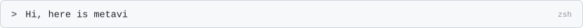
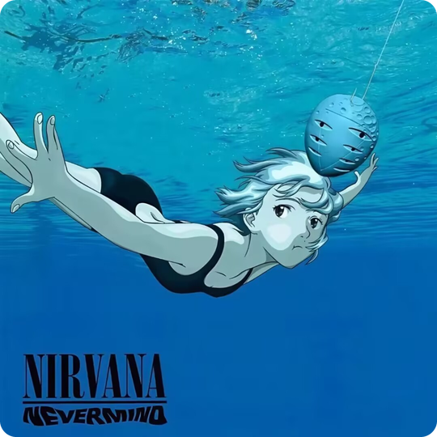

  <picture>
    <source media="(prefers-color-scheme: dark)" srcset="assets/greeting-dark.svg">
     Hi, here is metavi">
  </picture>

<pre><strong>metavixie@gmail.com</strong>
──────────────────
School  Zhejiang Normal University
Focus   CTF · Misc · Penetration
Tools   Python · Java · GDScript
Blog    <a href="https://metaviii.github.io/">https://metaviii.github.io/</a>
Notes   <a href="https://metaviii.github.io/2026/01/2025年终总结/">2025 Summary</a>
Hobby   Music, Anime, Philosophy</pre>

  

  
  
  

  <picture>
    <source media="(prefers-color-scheme: dark)" srcset="assets/divider-dark.svg">
    
  </picture>

  <picture>
    <source media="(prefers-color-scheme: dark)" srcset="assets/github-snake-dark.svg">
    
  </picture>

  <picture>
    <source media="(prefers-color-scheme: dark)" srcset="https://metavi-spotify.metavixie.workers.dev/?theme=dark">
    
  </picture>

