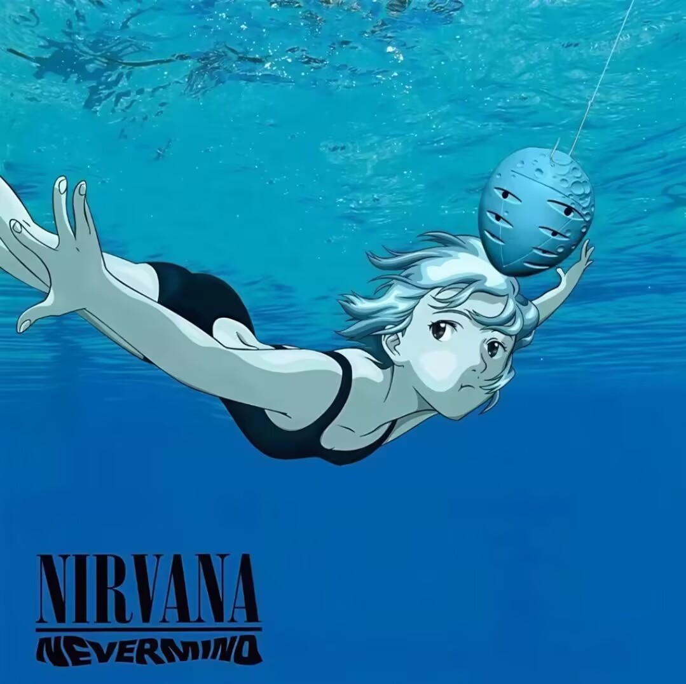

```zsh
> Hi, here is metavi
```



<pre><strong>metavixie@gmail.com</strong>
──────────────────
School  Zhejiang Normal University
Focus   CTF · Misc
Tools   Python · Godot
Blog    <a href="https://metaviii.github.io/">个人博客</a>
Notes   <a href="https://metaviii.github.io/2024/11/Misc-Ultra/">Misc Ultra</a>
Hobby   Music, Game, Philosophy</pre>

<p></p>

<br>

<p align="left">
  
  
  
</p>

<p align="center"></p>

<p align="center">
  <picture>
    <source media="(prefers-color-scheme: dark)" srcset="assets/contributions-dark.gif">
    
  </picture>
</p>
